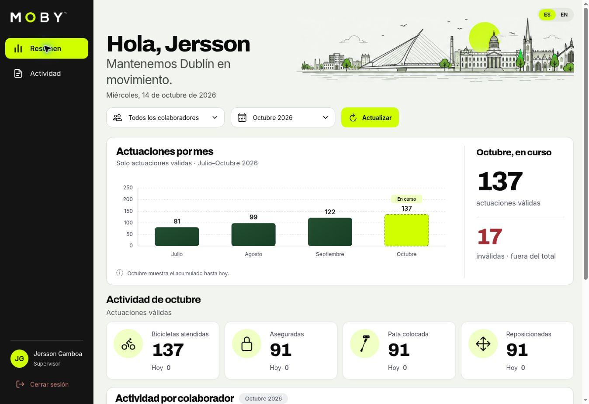

# MOBY Ops

Registro de operaciones de calle y revisión de evidencias para el equipo de MOBY
en Dublín. Un empleado registra una actuación terminada sobre una bicicleta;
la web permite consultar la actividad del equipo con datos reales.

**Estado documentado:** 14 de octubre de 2026, `main` después del PR #4
(commit de integración `38496c2`, implementación responsive `a8b8037`).
[Web desplegada](https://moby-ops-web.vercel.app).

## La aplicación desplegada

Captura real del dashboard web, 14 de octubre de 2026. Los valores corresponden
al entorno con datos de demostración, no a productividad operativa.



[Ver las capturas actuales y su contexto](docs/current-app-views.md).

## Qué incluye

- **Móvil:** invitación, configuración de contraseña, acceso, Public Order con
  escaneo/ID, candado, pata y reposicionamiento, fotos antes/después, ubicación
  puntual y consulta de actuaciones propias. Interfaz ES/EN.
- **Web:** acceso de supervisor activo, Summary con filtros, gráfica mensual,
  métricas mes/hoy y colaboradores; Activity con búsqueda, paginación y detalle
  de evidencia privada. Vistas de escritorio y móvil.
- **Datos:** Supabase Auth, PostgreSQL y Storage privado. La validez se calcula
  por empleado, bicicleta y día de Dublín; las repetidas se conservan aparte.

La web es de consulta: no administra cuentas, no asigna tareas y no edita
actuaciones. Manager es un uso de negocio: el esquema implementa `employee`
y `supervisor`, no un tercer rol `manager`.

## Un repositorio, dos proyectos

| Carpeta | Responsabilidad | Comandos desde |
| --- | --- | --- |
| `app/`, `src/`, `assets/` | Aplicación Expo / React Native | Raíz |
| `web/` | Next.js App Router / React / Tailwind | `web/` |
| `supabase/migrations/` | Esquema, funciones y políticas versionadas | Revisión SQL |
| `supabase/tests/` | Comprobaciones de acceso e integridad SQL | Entorno de BD controlado |
| `supabase/demo/` | Carga/retirada explícita de datos de demostración | Procedimiento separado |
| `docs/` | Guías actuales, decisiones y registros técnicos | Lectura |

Cada proyecto tiene su `package.json` y lockfile. No hay npm workspaces.
`npm run web` en la raíz ejecuta Expo Web; **el dashboard Next.js está en `web/`**.

## Primer arranque

Node 22 compatible con ambos proyectos; la web declara `^22.12.0 || ^24.0.0`.
Instalar con los lockfiles, sin actualizar dependencias como parte del arranque.
Las variables son del mismo proyecto Supabase, con nombres distintos por cliente.

```bash
# Móvil: desde la raíz
npm ci
cp .env.example .env
# Editar .env con URL y publishable key
npx expo start --dev-client
```

El flujo de enlaces y las capacidades nativas se validan con development build.
Expo Go no sustituye esa validación; ver [desarrollo local](docs/development.md).

```bash
# Dashboard web
cd web
npm ci
cp .env.example .env.local
# Editar .env.local antes de iniciar
npm run dev
```

La cuenta debe existir en Auth y tener un perfil adecuado. Autenticarse no
concede automáticamente acceso de supervisor. No crear perfiles ni ejecutar
migraciones por el solo hecho de clonar el repositorio.

## Dónde continuar

- [Índice de documentación](docs/README.md): ruta de lectura y estado de documentos.
- [Arquitectura y datos](docs/architecture.md): límites, flujos y contratos.
- [Decisiones](docs/decisions.md): contexto, alternativas y consecuencias.
- [Desarrollo](docs/development.md), [pruebas](docs/testing.md) y
  [seguridad](docs/security.md).
- [Despliegue y diagnóstico](docs/deployment.md).
- [Guía específica del dashboard](web/README.md).

## Límites conocidos

No hay cola offline persistente, relación de equipos/organizaciones ni catálogo
de flota. MFA y recuperación/invitación dentro de la web no están implementados.
El circuito móvil de invitación/contraseña es independiente. La configuración
EAS Update no acredita por sí sola recepción de OTA en todos los dispositivos.
Una foto firmada puede seguir accesible hasta su caducidad. Véanse los límites
explicados en las guías, antes de ampliar el uso operativo.

Los datos demo no son productividad real. Mantenerlos identificados durante una
presentación y seguir su [procedimiento](docs/dashboard-demo-data.md).
