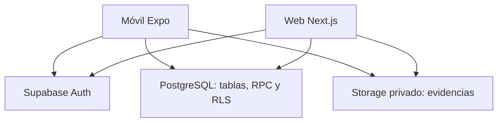

# Arquitectura y recorrido de los datos

Estado del código: `main`, PR #4 (`38496c2`), 14 de octubre de 2026.

## Límites del sistema

La web no hace de backend de envío para Expo. Ambos clientes usan Supabase con
la sesión del usuario; SQL es la autoridad común. El repo concentra el producto,
pero el build y las dependencias de Expo y Next.js permanecen independientes.

| Directorio | Qué debe contener |
| --- | --- |
| `app/` | Rutas Expo; acceso y navegación operativa |
| `src/features/` | Pantallas, hooks y comportamiento móvil por funcionalidad |
| `src/lib/supabase/` | Adaptador seguro, sesión, envío y lectura propia |
| `web/src/app/` | Rutas, páginas de servidor, acciones de acceso y endpoint de detalle |
| `web/src/components/` | Presentación e interacción del dashboard |
| `web/src/lib/` | Validación de URL, autorización, clientes y lectores tipados |
| `supabase/migrations/` | Esquema, ACL, RLS y funciones versionadas |

## Registrar una actuación

1. La pantalla móvil reúne ID, al menos una acción, fotos antes/después y
   ubicación puntual. Los rechazos de formato no son actuaciones guardadas.
2. `prepare_public_order` obtiene el empleado de `auth.uid()`, exige perfil
   activo y devuelve ID de actuación y rutas de subida vinculadas al usuario.
3. `submit-public-order.ts` consulta `public_order_receipt` antes de reintentar,
   sube ambas fotos sin sobrescribir y llama a `submit_public_order`.
4. SQL vuelve a comprobar perfil, formato, acciones, coordenadas, fechas,
   propietario, rutas y metadatos de Storage. En una transacción inserta actuación,
   evidencias y evento. Las subidas de Storage ocurren **antes** de esa transacción:
   no hay una transacción distribuida entre archivos y tablas.
5. La UI confirma éxito tras la respuesta del servidor. Un reintento con el mismo
   `action_id` devuelve el recibo existente; un nuevo ID constituye otra actuación.

Código: [cliente móvil](../src/lib/supabase/submit-public-order.ts),
[funciones de envío](../supabase/migrations/submit_public_order.sql).
Límite: el borrador/reintento en memoria no es una cola offline; una interrupción
puede dejar objetos privados sin una actuación asociada.

## Modelo mínimo y validez

`profiles` enlaza con Auth; `public_order_actions` registra empleado, bicicleta,
acciones, observaciones, coordenadas y tiempos. `action_evidence` enlaza rutas y
fases, y `action_events` registra el evento de creación. No hay una tabla de
flota ni pertenencia a equipo/organización que reduzca el alcance del supervisor.

La validez es **derivada en consultas**: primera actuación por `employee_id`,
`bike_external_id` y fecha de `created_at` en `Europe/Dublin`, ordenada por
`created_at,id`. Las posteriores conservan su registro y se muestran inválidas.
`performed_at` del teléfono no determina el día de cómputo.

Ejemplo: dos actuaciones del mismo empleado sobre la misma bicicleta y día
producen una válida y una inválida. Un segundo empleado puede aportar otra válida.
Tres acciones marcadas en una actuación aportan una atendida y hasta tres métricas
de tarea, no tres atendidas. Las acciones de una inválida no se suman a métricas válidas.

## Leer Summary

[La página](../web/src/app/page.tsx) exige supervisor activo, valida filtros y
consulta métricas, selector de colaboradores y tabla de equipo en paralelo.
La serie mensual reutiliza el mes ya leído y pide hasta tres meses anteriores;
no hay un RPC exclusivo de gráfica ni Recharts en la implementación.

| Lectura pública | Resultado usado |
| --- | --- |
| `read_team_summary_metrics_filtered` | Mes seleccionado, día actual de Dublín, cifras mes/hoy |
| `read_team_summary_collaborators` | ID, nombre y estado activo para filtros |
| `read_team_summary_by_collaborator` | Cinco cifras por persona y total del equipo |

«Hoy» siempre es el día actual del servidor, incluso con un mes histórico
seleccionado. Un error, denegación o contrato inválido no equivale a un cero real.
Los lectores validan estructura de respuesta antes de entregarla a componentes.

## Leer Activity y su evidencia

`read_team_activity` clasifica duplicados antes de búsqueda, filtro de validez
 y paginación. Orden descendente por `created_at,id`, 25 registros por página.
`as_of` limita las inserciones posteriores al corte; no es una instantánea
persistente frente a modificaciones administrativas ni convierte OFFSET en cursor.

[El endpoint de detalle](../web/src/app/activity/detail/route.ts) exige sesión,
valida ID/corte y llama a `read_team_activity_detail`. El lector firma rutas
registradas durante 300 segundos con el cliente del usuario. La lista no descarga
fotos, notas ni coordenadas para todos los registros. Una firma fallida se muestra
como tal; no se inventa una evidencia ausente.

## Estado, caché y presentación

Los filtros viven en la URL. Estado local: apertura, idioma, borrador de búsqueda,
panel y zoom. Sesión no vive en esos estados. Next usa cliente por petición,
`fetch` con `cache: "no-store"` y páginas dinámicas; detalle añade cabeceras privadas.
No se implementa realtime: entrar, cambiar filtros o Actualizar inicia lecturas.

En móvil, CSS adapta los mismos datos: menú disclosure, métricas 2 × 2 y filas
expandibles. El gráfico usa dos SVG decorativos con tabla accesible única.
La presentación de un botón o fila no modifica una regla de autorización SQL.

[Decisiones](decisions.md) · [Seguridad](security.md) · [Pruebas](testing.md).
