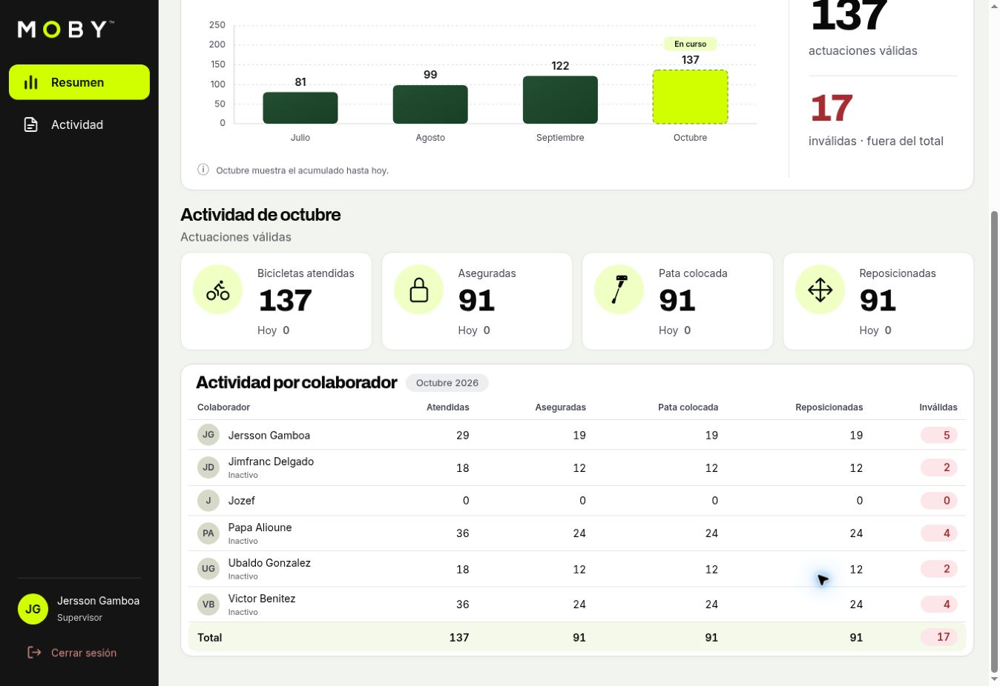
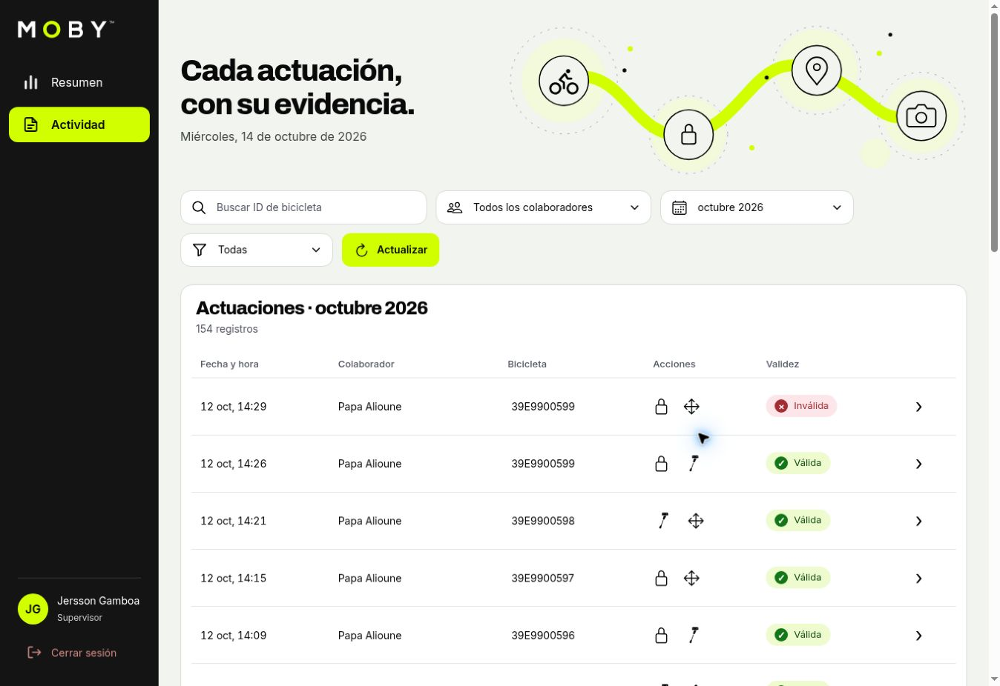

# Vistas actuales de la aplicación web

Capturas obtenidas directamente de [la aplicación desplegada](https://moby-ops-web.vercel.app)
el **14 de octubre de 2026**, con una sesión de supervisor y el idioma español.
Son imágenes de la interfaz ejecutándose, sin recreación gráfica ni cambios
artificiales de estilos o contenidos.

## Contexto de captura

| Dato | Valor |
| --- | --- |
| Aplicación | Dashboard Next.js de `web/`; no aplicación nativa Expo |
| Entorno | Web desplegada en Vercel |
| Periodo seleccionado | Octubre de 2026 |
| Colaborador | Todos los colaboradores |
| Datos | Instancia con datos de demostración; no productividad operativa |
| Formato | JPEG, 1348 × 926 píxeles por imagen |
| Alcance | Vistas de escritorio; capturas móviles pendientes |

El tamaño indicado es el de los archivos, no una certificación del viewport CSS
ni una prueba sobre un modelo de teléfono. Las capturas registran el estado
visible en esa fecha; sus totales cambian con los datos y el periodo consultado.
La revisión responsive de código se documenta por separado en la
[guía móvil](web-mobile-responsive.md).

## Summary: lectura del periodo

Los filtros anteceden a los resultados. La gráfica diferencia el mes en curso
y separa las actuaciones inválidas del total válido. Las cuatro tarjetas de
actividad tienen el mismo tratamiento de fondo: ninguna simula una selección.

## Summary: actividad por colaborador

Esta segunda captura corresponde a la misma página después de desplazarse.
Permite leer todos los colaboradores y el total del equipo. El estado inactivo
se muestra sin borrar su aportación histórica. En esta consulta se observan
137 actuaciones válidas y 17 inválidas.

## Activity: listado del mes

Se seleccionó el modo mensual en el filtro de fecha y se mantuvo la validez en
«Todas». El listado muestra 154 registros: válidos e inválidos. Esa cifra es
coherente con los 137 válidos más 17 inválidos del resumen. La imagen muestra
la parte superior de la primera página, no la totalidad del listado.

La bicicleta abre el detalle autorizado; los iconos permiten reconocer las
acciones realizadas. Ver [contrato del listado](web-activity-list.md) y
[detalle de evidencia](web-activity-detail-panel.md).

## Completar y mantener las imágenes

Las vistas móviles no se representan con mockups. Añadir capturas actuales de
Summary, menú abierto, colaboradores desplegados y Activity con una fila
expandida cuando estén disponibles. Registrar fecha, idioma, filtros y estado
visible, sin presentar una emulación como una captura de teléfono físico.

Para actualizar estas imágenes:

1. Abrir la versión desplegada y comprobar que la carga haya terminado.
2. Seleccionar un periodo de demostración con datos y anotar los filtros.
3. Capturar la interfaz sin modificar sus estilos ni reemplazar textos.
4. Revisar que no aparezcan credenciales, tokens, URLs de evidencia firmadas ni
   fotografías o ubicaciones de operaciones privadas.
5. Sustituir los archivos de `docs/screenshots/web/` y actualizar este contexto.

Estas imágenes no sustituyen las pruebas de acceso, la revisión de responsive
ni la comprobación del despliegue. Los mockups históricos de `docs/design/`
son referencias de diseño; esta galería es la evidencia visual de la aplicación
actual en la fecha indicada.
